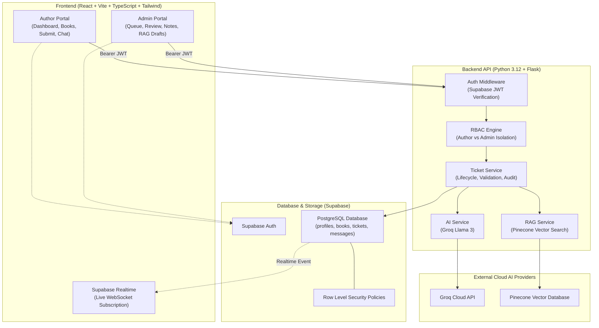

# BookLeaf Publishing — AI-Powered Author Support & Communication Portal

> **Confidential Technical Assessment**  
> Built for BookLeaf Publishing to streamline author communication across 22,000+ titles and 1,200+ monthly releases.

---

## 1. Project Overview
BookLeaf Publishing operates across India and the US, providing author publishing packages, cover design, typesetting, ISBN assignments, printing, retail distribution, and quarterly royalty management. 

This platform provides two dedicated, role-based portals:
1. **Author Portal**: Authors inspect their published books and production stages, review quarterly royalty earnings, submit inquiries, and engage in real-time support conversations.
2. **Operations Admin Portal**: BookLeaf staff manage an intelligent global ticket queue powered by Groq LLM auto-classification (6 categories, 4 priorities), Pinecone RAG policy retrieval, AI draft generation, private internal notes, and administrative overrides.

---

## 2. Feature Highlights

- **Role-Based Portals**: Isolated experiences for `author` and `admin` with strict database-level Row-Level Security (RLS).
- **Author Dashboard**: Real calculated metrics (total books, copies sold, royalty earned, paid, and pending balance).
- **My Books Catalog**: Displays all book metadata (MRP, royalty/copy, ISBN, print partner, retail platforms).
- **End-to-End Ticket Lifecycle**: Submissions default to `Open`, automatically triage through AI, advance to `In Progress` upon admin reply, and transition to `Resolved` / `Closed`.
- **Groq AI Triage**: Fast JSON classification into the 6 exact categories and 4 priority tiers with confidence and reasoning.
- **Pinecone Vector RAG**: Semantically chunks and embeds BookLeaf policies; retrieves relevant policy excerpts for grounded drafting.
- **Admin Review & Override**: Staff can override AI categories or priorities; original AI prediction is audited.
- **Private Internal Notes**: Admins can record internal investigations that are strictly hidden from author endpoints, UI, and AI prompts.
- **Real-Time Streaming**: Supabase Realtime WebSocket subscriptions update conversations and ticket statuses live.
- **Resilient Offline Fallback**: Complete functionality remains available if Groq, Pinecone, or Supabase credentials are not connected.

---

## 3. Architecture Diagram



---

## 4. Technology Stack & Justification

| Layer | Technology | Justification |
|---|---|---|
| **Frontend** | React 18, Vite, TypeScript | Modern developer experience, sub-second HMR, strict type safety. |
| **Styling** | Tailwind CSS, Lucide Icons | Responsive SaaS dashboard aesthetic with restrained navy/blue palette. |
| **Charts** | Recharts | Composable SVG data visualizations for ticket queue status & category distributions. |
| **Backend** | Python 3.12, Flask, Flask-CORS | Lightweight, modular micro-framework; native SDK support for AI & vector databases. |
| **Validation** | Pydantic v2 | Robust schema parsing and enum enforcement for API payloads. |
| **Database** | Supabase PostgreSQL | Reliable relational engine with native Row Level Security (RLS) and Realtime changefeeds. |
| **Authentication** | Supabase Auth | Secure email/password authentication with JWT verification on Flask backend. |
| **LLM Inference** | Groq API (`llama-3.3-70b-versatile`) | Industry-leading inference speed (~300 tokens/sec) for rapid triage and drafting. |
| **Vector DB** | Pinecone | Serverless, low-latency vector search for semantic retrieval of BookLeaf policies. |
| **Testing** | Pytest | Automated test coverage for RBAC, author isolation, internal notes protection, and AI fallbacks. |

---

## 5. Prerequisites

- **Node.js**: v18+ (tested on Node v22)
- **Python**: v3.11+ (tested on Python 3.12)
- **Package Managers**: npm, pip

---

## 6. Local Setup Instructions

Clone the repository:
```bash
git clone <private-repository-url> bookleaf-portal
cd bookleaf-portal
```

---

## 7. Frontend Installation & Startup

```bash
# Navigate to frontend
cd frontend

# Install dependencies
npm install

# Start development server
npm run dev
```
The frontend starts at `http://localhost:5173`.

---

## 8. Backend Installation & Startup

```bash
# Navigate to backend
cd backend

# Create virtual environment (optional)
python -m venv venv
# Windows: venv\Scripts\activate | Unix: source venv/bin/activate

# Install dependencies
pip install -r requirements.txt

# Start backend server
python run.py
```
The Flask backend runs at `http://localhost:5000` with the `/api/v1` API prefix.

---

## 9. Environment Variable Configuration

### Backend (`backend/.env`)
Copy `backend/.env.example` to `backend/.env`:
```env
FLASK_ENV=development
FLASK_DEBUG=1
PORT=5000
FRONTEND_ORIGIN=http://localhost:5173

# Supabase Credentials
SUPABASE_URL=https://your-project.supabase.co
SUPABASE_SERVICE_ROLE_KEY=your-service-role-key-here
SUPABASE_ANON_KEY=your-anon-key-here
SUPABASE_JWT_SECRET=your-jwt-secret-here

# Groq Cloud AI
GROQ_API_KEY=gsk_your_groq_api_key_here
GROQ_MODEL=llama-3.3-70b-versatile

# Pinecone Vector Database
PINECONE_API_KEY=your-pinecone-api-key-here
PINECONE_INDEX_NAME=bookleaf-knowledge-base
PINECONE_ENVIRONMENT=us-east-1

# Embedding Configuration
EMBEDDING_PROVIDER=local
EMBEDDING_DIMENSION=384
```

### Frontend (`frontend/.env`)
Copy `frontend/.env.example` to `frontend/.env`:
```env
VITE_SUPABASE_URL=https://your-project.supabase.co
VITE_SUPABASE_ANON_KEY=your-anon-key-here
VITE_API_BASE_URL=http://localhost:5000/api/v1
```

---

## 10. Supabase Schema & Migration Instructions

1. Open your Supabase Project Dashboard -> **SQL Editor**.
2. Run `backend/migrations/001_initial_schema.sql` to generate tables (`profiles`, `books`, `tickets`, `ticket_messages`, `ai_processing_logs`), indexes, RLS policies, and Realtime publications.
3. Run `backend/migrations/002_auth_trigger.sql` to enable the user creation trigger.

---

## 11. Authentication & Role Configuration

Roles are stored in `public.profiles.role` (`author` or `admin`).
- **Server Verification**: The backend verifies Bearer tokens via Supabase Auth and fetches the user's role from `profiles`.
- **RBAC**: Protected routes enforce `@require_role('admin')` or `@require_role('author')`.
- **RLS**: PostgreSQL enforces author row isolation. Authors can only select/insert records with `author_id = auth.uid()`.

---

## 12. Official Sample-Data Import Instructions

The assignment dataset `bookleaf_sample_data.json` containing the **10 authors and 18 books** is located in `backend/data/bookleaf_sample_data.json`.

To seed a live Supabase PostgreSQL database:
```bash
python backend/scripts/seed_data.py
```
*Note: If external Supabase credentials are not yet configured, the backend automatically initializes an in-memory store with this exact dataset so all 10 authors and 18 books are immediately testable.*

---

## 13. Pinecone Index Setup & Knowledge Ingestion

To create the Pinecone index and ingest BookLeaf operational policies:
```bash
python backend/scripts/ingest_knowledge_base.py
```
This parses the 7 official policy documents, embeds them with the configured embedding model, and upserts them into namespace `bookleaf-policies`.

---

## 14. Groq Model Configuration

The application reads `GROQ_MODEL` from environment variables (default: `llama-3.3-70b-versatile`, with support for `llama-3.1-8b-instant`).

---

## 15. AI Prompts & Classification Strategy

- **Prompt Design**: Structured system prompt enforcing the 6 exact BookLeaf categories and 4 priority tiers (`Critical`, `High`, `Medium`, `Low`).
- **JSON Output Mode**: Uses `response_format={"type": "json_object"}` for deterministic parsing into Pydantic schemas.
- **Admin Override**: Admins can override category or priority anytime; the original AI prediction remains audited in `ai_category` and `ai_priority`.

---

## 16. RAG Retrieval Flow

1. Author submits or admin opens ticket.
2. Query vector is projected.
3. Pinecone queries the `bookleaf-policies` namespace with category metadata filtering.
4. Top-3 policy chunks are injected into the Groq response draft prompt alongside author name, book sales, royalties, and tone guidelines.

---

## 17. AI Error Handling & Fallback Strategy

- **Graceful Degradation**: If Groq rate limits, times out, or fails, ticket creation is never blocked. A deterministic rule-based keyword classifier runs and assigns category/priority with `ai_status: "fallback"`.
- **Pinecone Fallback**: If Pinecone is offline, the system retrieves policy chunks from the local static knowledge base marked as `local_policy_fallback`.
- **Admin Review**: AI never sends messages directly to authors. Admins review and edit all suggested drafts.

---

## 18. Cost-Management Decisions

- **Token Economy**: Avoids passing entire ticket history or full policies. Retrieves only top-3 relevant chunks (<500 tokens).
- **Fast Inference**: Uses Llama 3 models on Groq for ultra-low token cost and rapid inference.
- **Audit Logging**: Logs token counts and operation latency in `ai_processing_logs`.

---

## 19. REST API Documentation

Comprehensive endpoint specifications, request bodies, and response schemas are documented in [`docs/api.md`](docs/api.md).

---

## 20. Automated Test Results

Execute the complete backend test suite:
```bash
python -m pytest backend/tests -v
```

**Results: 19 Passed in 0.58s**
- `test_health_check_endpoint`: PASSED
- `test_missing_authentication_header`: PASSED
- `test_invalid_bearer_token`: PASSED
- `test_valid_author_authentication`: PASSED
- `test_author_access_to_admin_route_forbidden`: PASSED
- `test_admin_access_to_admin_route_allowed`: PASSED
- `test_author_can_view_only_own_books`: PASSED
- `test_author_cannot_access_another_authors_book_detail`: PASSED
- `test_author_cannot_create_ticket_for_another_authors_book`: PASSED
- `test_author_cannot_access_another_authors_ticket`: PASSED
- `test_author_never_receives_internal_notes`: PASSED
- `test_ticket_creation_validation`: PASSED
- `test_status_update_and_invalid_status_rejection`: PASSED
- `test_admin_assignment`: PASSED
- `test_public_reply_advances_open_status`: PASSED
- `test_deterministic_ai_classification_fallback`: PASSED
- `test_rag_service_retrieval_and_fallback`: PASSED
- `test_ai_draft_response_grounding`: PASSED
- `test_admin_can_override_ai_classification`: PASSED

---

## 21. Deployment Instructions

### Frontend (Vercel)
- Root Directory: `frontend`
- Build Command: `npm run build`
- Output Directory: `dist`
- Configured with `frontend/vercel.json` for client-side routing fallback.

### Backend (Render / Railway)
- Root Directory: `backend`
- Build Command: `pip install -r requirements.txt`
- Start Command: `gunicorn --bind 0.0.0.0:$PORT run:app`
- Configured with `backend/Procfile` and `backend/render.yaml`.

---

## 22. Known Limitations
- File attachment uploads in this assignment stage validate format and file size client-side; cloud storage persistence requires an active private S3/Supabase Storage bucket.
- Background tasks run with bounded timeouts rather than a distributed Celery/Redis cluster.

---

## 23. Production Evolution Plan
1. Deploy Celery with Redis for distributed background processing.
2. Integrate private Supabase Storage buckets with pre-signed expiring download URLs.
3. Train a lightweight fine-tuned classifier on historical BookLeaf support tickets.

---

## 24. Demo Accounts & One-Click Login

On the Login screen (`/login`), click the one-click demo selectors to instantly evaluate either role:

1. **Author Demo (Priya Sharma)**:
   - Account: `priya.sharma@email.com`
   - Books: *Whispers of the Ganges*, *The Saffron Diaries*
   - Active royalties and sales metrics.
2. **Author Demo (Sneha Kulkarni)**:
   - Account: `sneha.kulkarni@email.com`
   - Books: *The Algorithm of Love*, *Ctrl+Alt+Delete My Ex*, *Midnight in Mysore* (In Production - Cover Design).
3. **Operations Lead (Admin Demo)**:
   - Account: `admin@bookleaf.in`
   - Full global ticket queue, AI classification review & override, internal notes, Pinecone RAG draft generator.
