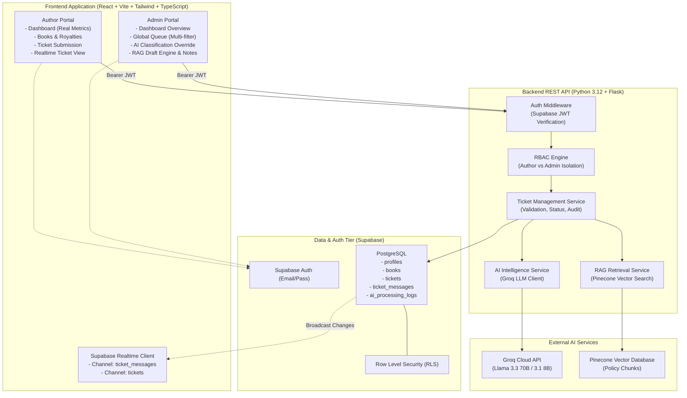
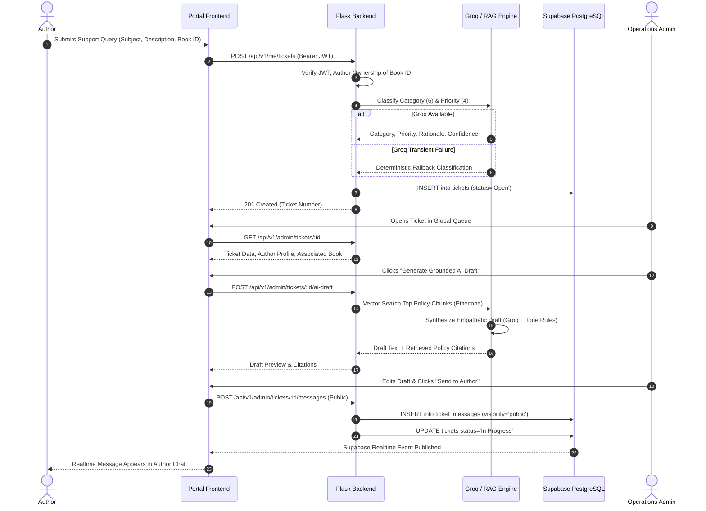
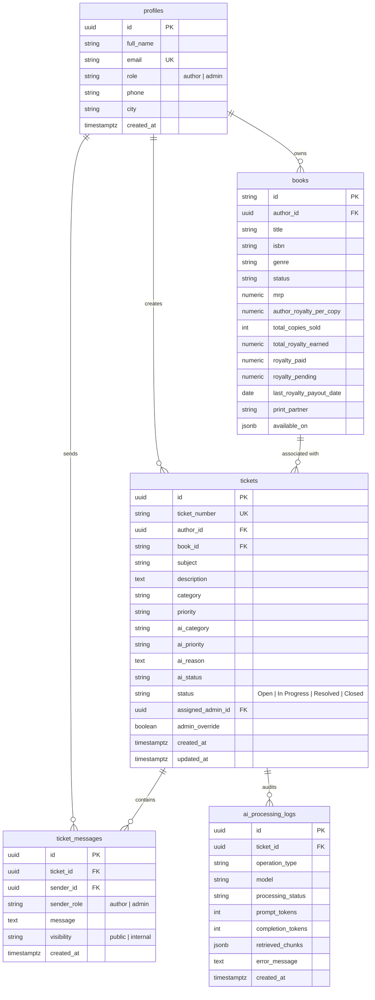

# BookLeaf Publishing — System Architecture & Data Flow

This document details the software architecture, data models, AI/RAG workflows, security controls, and failure-handling mechanisms for the BookLeaf Author Support & Operations Communication Portal.

---

## 1. High-Level Architecture Overview

---

## 2. End-to-End Ticket Lifecycle

---

## 3. Data Model & Entity Relationships

---

## 4. Security & Isolation Architecture

1. **Strict Client/Server Secret Boundary**:
   - The browser frontend exclusively receives the publishable `VITE_SUPABASE_ANON_KEY`.
   - `SUPABASE_SERVICE_ROLE_KEY`, `GROQ_API_KEY`, and `PINECONE_API_KEY` reside exclusively in the backend server environment.
2. **Server-Side Token Verification**:
   - Every protected route requires an `Authorization: Bearer <token>` header.
   - The Flask backend independently verifies token signature, expiry, and queries `public.profiles` to determine the user's role. Client-supplied IDs or roles are never trusted.
3. **Internal Notes Isolation**:
   - Messages have `visibility: 'public'` or `visibility: 'internal'`.
   - Authors can query only `visibility = 'public'`. Internal notes are filtered in both the database RLS policies and backend route handlers, and excluded from author-facing AI prompts.
4. **Author Data Isolation**:
   - Authors can only view or create tickets for books linked to their own `author_id`. Attempting to access another author's record results in an immediate `403 FORBIDDEN`.

---

## 5. Resilience & Fallback Design

| Component | Failure Mode | Mitigation Strategy |
|---|---|---|
| **Groq AI API** | Rate limit, outage, or timeout | Deterministic keyword and heuristic classifier assigns category and priority; marks `ai_status: 'fallback'`. Ticket creation is never blocked. |
| **Pinecone Vector DB** | Network timeout or unconfigured key | Local semantic & keyword scoring over in-memory BookLeaf Knowledge Base chunks (`source: 'local_policy_fallback'`). |
| **Groq Draft Engine** | Offline / Unavailable | Synthesizes grounded response template from retrieved policies, author data, and BookLeaf communication standards. |
| **Supabase Cloud DB** | Local development / Offline | High-performance in-memory service store initialized with the official `bookleaf_sample_data.json` records (10 authors, 18 books) for 100% deterministic test execution. |
| **Supabase Realtime** | WebSocket disconnect | Graceful polling & refresh fallback with automatic reconnection logic. |
